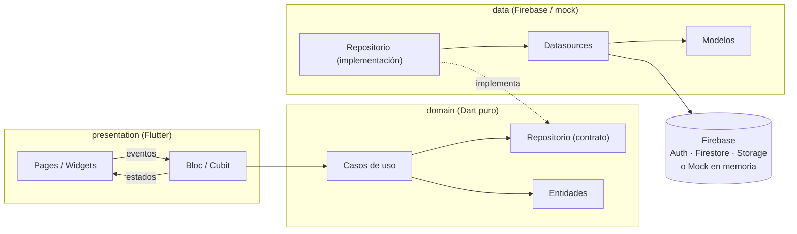
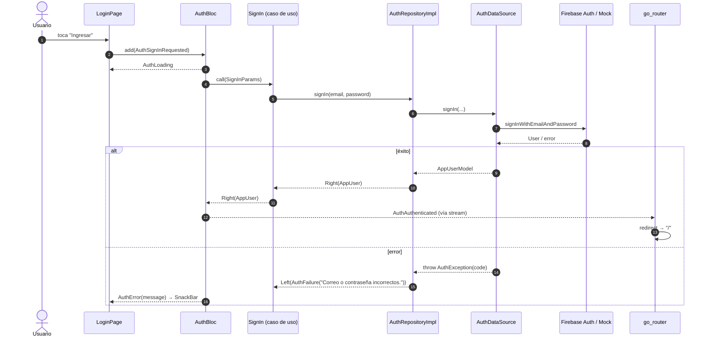
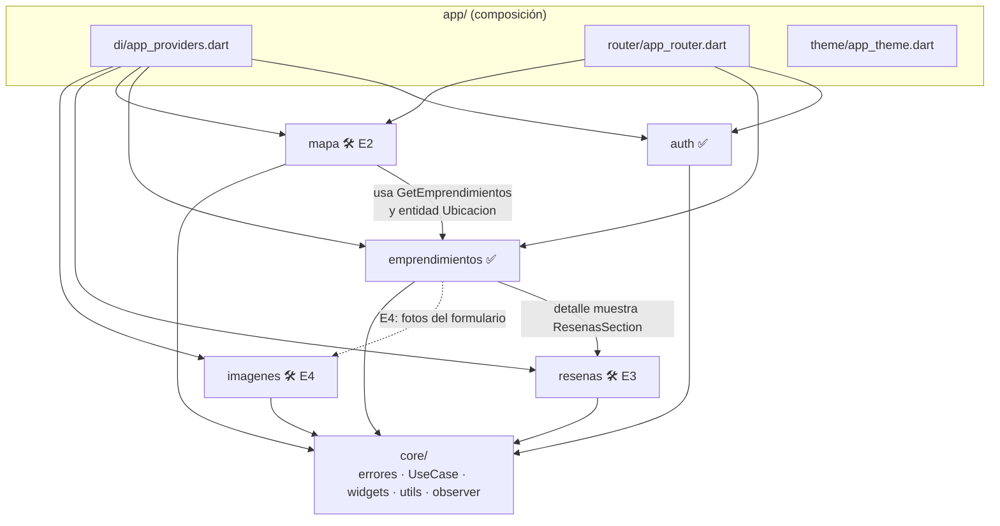
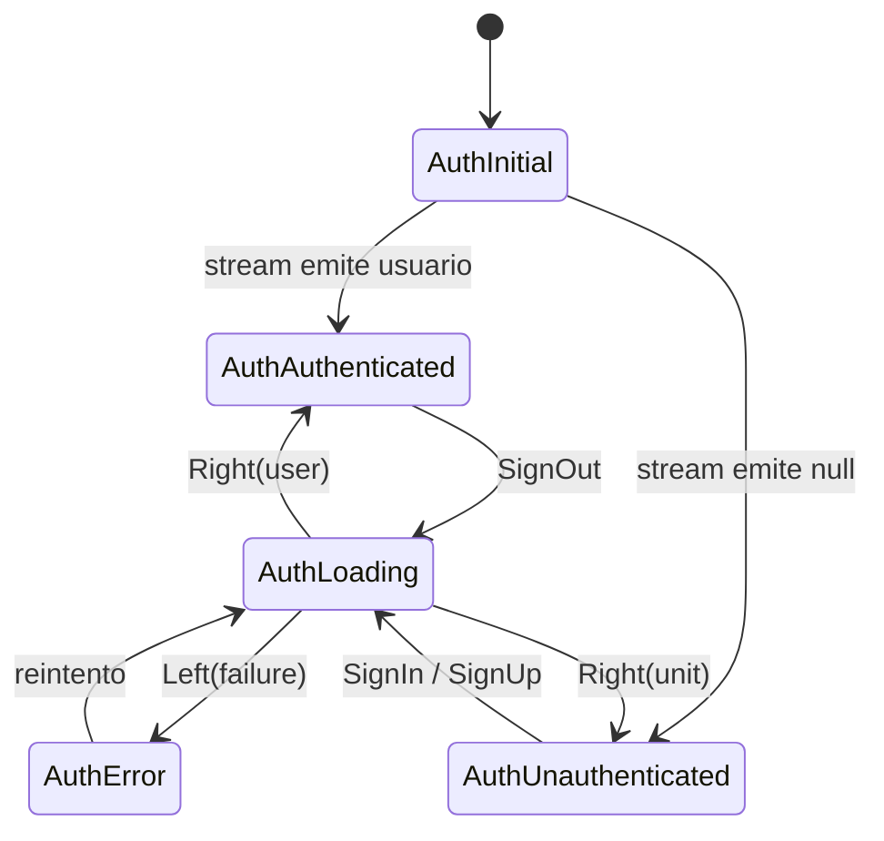
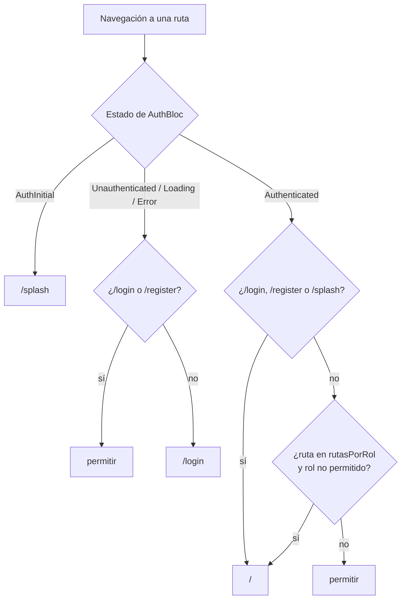
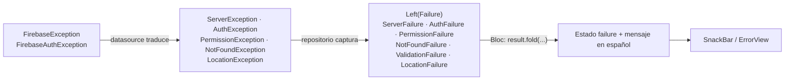
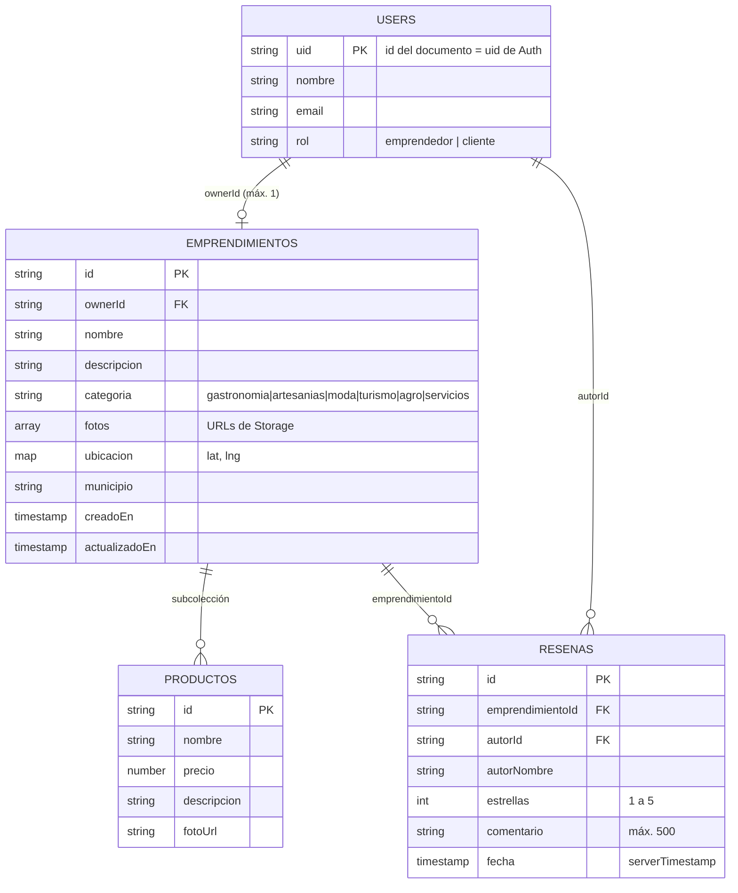
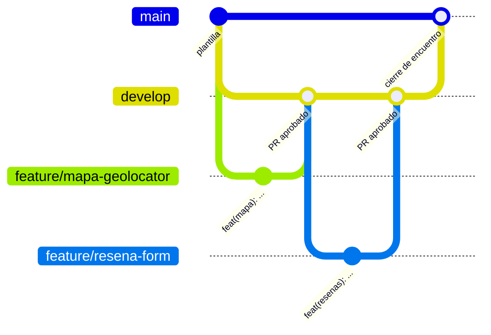

# Vitrina Regional

> App móvil que da **visibilidad a emprendedores locales** de Villavicencio y el
> Meta: los clientes exploran emprendimientos, los ven en un mapa y dejan
> reseñas en tiempo real.

Proyecto **COIL** (Collaborative Online International Learning) de dos semanas
entre equipos mixtos de **UNIMINUTO** y **AUNAR Villavicencio**. Este
repositorio es la **plantilla base**: las features `auth` y `emprendimientos`
están completas como referencia, y `mapa`, `resenas` e `imagenes` tienen la
estructura lista con tareas `TODO(COIL-Ex-n)` para construir en los encuentros.

> 📋 **Tareas por semana:** el plan completo de los 4 encuentros (tareas,
> puntos, criterios de aceptación, pistas, entregables, rúbrica y tablero de
> avance) está en **[docs/PLAN_DE_TAREAS.md](docs/PLAN_DE_TAREAS.md)**.

| Encuentro | Semana | Tema | Tareas | Puntos |
| --------- | :----: | ---- | :----: | :----: |
| E1 | 1 | Fundamentos, arquitectura y Firebase | 6 | 12 |
| E2 | 1 | Mapa y geolocalización | 6 | 12 |
| E3 | 2 | Reseñas en tiempo real | 6 | 12 |
| E4 | 2 | Imágenes, integración y demo final | 6 | 12 |

---

## Tabla de contenido

1. [Versiones del entorno](#1-versiones-del-entorno)
2. [Inicio rápido (modo mock, sin Firebase)](#2-inicio-rápido-modo-mock-sin-firebase)
3. [Arquitectura](#3-arquitectura)
4. [Estructura de carpetas](#4-estructura-de-carpetas)
5. [Gestión de estado (flutter_bloc)](#5-gestión-de-estado-flutter_bloc)
6. [Inyección de dependencias](#6-inyección-de-dependencias)
7. [Navegación y roles (go_router)](#7-navegación-y-roles-go_router)
8. [Manejo de errores](#8-manejo-de-errores)
9. [Modelo de datos en Firebase](#9-modelo-de-datos-en-firebase)
10. [Ejecutar con Firebase](#10-ejecutar-con-firebase)
11. [Pruebas y calidad](#11-pruebas-y-calidad)
12. [Colaboración: ramas, commits y PR](#12-colaboración-ramas-commits-y-pr)
13. [Plan por encuentros y TODOs](#13-plan-por-encuentros-y-todos)
14. [Preguntas frecuentes](#14-preguntas-frecuentes)

---

## 1. Versiones del entorno

El proyecto se creó y verificó con estas versiones. **Usen la misma versión de
Flutter** en todo el equipo (y es la que fija el CI):

| Herramienta | Versión |
| ----------- | ------- |
| **Flutter** | **3.47.7** (canal `stable`, revisión `abaf9c5237`, 2026-10-08) |
| **Dart**    | **3.13.5** |
| DevTools    | 2.60.0 |
| Restricción SDK (`pubspec.yaml`) | `sdk: ^3.13.5` |

Comprueben su versión con:

```bash
flutter --version
```

Si tienen otra versión: `flutter upgrade` (o `flutter downgrade` / FVM para fijar
la 3.47.7).

### Dependencias principales

| Paquete | Versión | Para qué |
| ------- | ------- | -------- |
| `material_ui` | ^1.9.0 | Librería Material (desde Flutter 3.44 vive fuera del SDK; se importa `package:material_ui/material_ui.dart`) |
| `flutter_bloc` / `bloc` | ^9.1.1 / ^9.2.1 | Gestión de estado (Bloc y Cubit) + inyección con `RepositoryProvider` |
| `go_router` | ^18.1.2 | Navegación declarativa con `redirect` según la sesión |
| `firebase_core` | ^5.1.0 | Inicialización de Firebase |
| `firebase_auth` | ^7.0.1 | Autenticación por correo/contraseña |
| `cloud_firestore` | ^7.1.0 | Base de datos en tiempo real |
| `http` | ^1.2.2 | Subida de imágenes a Cloudinary (upload preset *unsigned*) |
| `fpdart` | ^1.2.0 | `Either<Failure, T>` para errores tipados |
| `equatable` | ^3.0.0 | Igualdad por valor en entidades y estados |
| `geolocator` | ^14.1.2 | Ubicación del dispositivo (E2) |
| `flutter_map` + `latlong2` | ^8.3.2 / ^0.10.1 | Mapa con OpenStreetMap (sin API key) |
| `image_picker` | ^1.2.4 | Cámara / galería (E4) |
| `flutter_image_compress` | ^2.5.1 | Comprimir antes de subir (E4) |
| `cached_network_image` | ^4.0.6 | Imágenes remotas con caché |
| `intl` | ^0.20.3 | Formato de moneda y fechas en español |
| `bloc_test`, `mocktail`, `flutter_test` | ^10.0.0, ^1.0.5, SDK | Pruebas |
| `flutter_lints` | ^6.0.0 | Lints (+ reglas estrictas en `analysis_options.yaml`) |

---

## 2. Inicio rápido (modo mock, sin Firebase)

El día 1 **nadie necesita Firebase**: la app trae datasources en memoria con 6
emprendimientos reales del Meta.

```bash
# 1. Verifica tu entorno (Android Studio/SDK, Chrome o un emulador)
flutter doctor

# 2. Clona y entra
git clone https://github.com/clavijo99/vitrina-regional.git
cd vitrina-regional

# 3. Dependencias
flutter pub get

# 4. Ejecuta (emulador Android, dispositivo físico o Chrome)
flutter run            # o: flutter run -d chrome
```

El interruptor está en `lib/app/di/app_providers.dart`:

```dart
const bool useMockData = true; // true = mock, false = Firebase
```

**Usuarios de prueba** (contraseña `123456`):

| Correo | Rol | Qué puede hacer |
| ------ | --- | --------------- |
| `emprendedor@demo.com` | Emprendedor | Ver y **editar** "Mi emprendimiento" (ya tiene *Café de Origen Llanero*) |
| `cliente@demo.com` | Cliente | Explorar, ver el **mapa** y **reseñar** |

También pueden registrar usuarios nuevos (se pierden al reiniciar la app).

---

## 3. Arquitectura

### 3.1 Clean Architecture por features

Cada feature (`auth`, `emprendimientos`, `mapa`, `resenas`, `imagenes`) tiene
**tres capas**. La regla de oro: **las dependencias apuntan hacia adentro**
(presentation → domain ← data). `domain` no conoce a nadie.



| Capa | Contiene | Puede importar | NO puede importar |
| ---- | -------- | -------------- | ----------------- |
| **domain** | Entidades, contratos de repositorio, casos de uso, reglas de negocio | `equatable`, `fpdart`, `core/` | Flutter, Firebase, `data/`, `presentation/` |
| **data** | Modelos (`fromMap`/`toMap`), datasources (Firebase y mock), implementaciones de repositorio | `domain`, Firebase, `core/` | `presentation/` |
| **presentation** | Blocs/Cubits, páginas, widgets | `domain`, Flutter, `core/` | `data/` (salvo la composición en `app/di`) |

**¿Por qué?**

- **Probar sin Firebase:** los Blocs dependen de casos de uso que se simulan con `mocktail`.
- **Cambiar el backend con un flag:** `useMockData` intercambia datasources sin tocar UI ni Blocs.
- **Trabajar en paralelo:** un equipo hace la UI mientras otro hace el datasource; el contrato de domain los une.

### 3.2 Flujo de una petición (ejemplo: iniciar sesión)



Observa que **la página nunca navega a mano**: solo cambia el estado del
`AuthBloc` y `go_router` reacciona.

### 3.3 Mapa de features



✅ = completa (referencia) · 🛠️ = estructura + TODOs para el encuentro indicado.

---

## 4. Estructura de carpetas

```text
vitrina_regional/
├── lib/
│   ├── main.dart                         # bootstrap: Firebase (si no es mock), intl, Bloc.observer, runApp
│   ├── firebase_options.dart             # PLACEHOLDER (lo reemplaza `flutterfire configure`)
│   ├── firebase_options.dart.example     # forma del archivo generado
│   ├── app/
│   │   ├── app.dart                      # MaterialApp.router + temas
│   │   ├── di/app_providers.dart         # useMockData + MultiRepositoryProvider + MultiBlocProvider
│   │   ├── router/
│   │   │   ├── app_router.dart           # rutas, redirect por sesión y por rol
│   │   │   ├── app_routes.dart           # constantes de rutas
│   │   │   └── go_router_refresh_stream.dart
│   │   └── theme/app_theme.dart          # Material 3 claro/oscuro
│   ├── core/
│   │   ├── bloc/app_bloc_observer.dart
│   │   ├── error/{failures,exceptions}.dart
│   │   ├── usecase/usecase.dart          # UseCase<T, Params>, StreamUseCase, NoParams
│   │   ├── utils/{validators,formatters}.dart
│   │   └── widgets/                      # PrimaryButton, AppTextField, Loading/Empty/ErrorView, AppNetworkImage
│   └── features/
│       ├── auth/                         # ✅ completa
│       │   ├── domain/   entities/app_user.dart · repositories/auth_repository.dart
│       │   │             usecases/{sign_in,sign_up,sign_out,watch_auth_state}.dart
│       │   ├── data/     models/app_user_model.dart
│       │   │             datasources/{auth_remote_datasource,auth_mock_datasource}.dart
│       │   │             repositories/auth_repository_impl.dart
│       │   └── presentation/ bloc/auth_{bloc,event,state}.dart · cubit/login_form_cubit.dart
│       │                     pages/{splash,login,register}_page.dart · auth_context_extension.dart
│       ├── emprendimientos/              # ✅ completa
│       │   ├── domain/   entities/{emprendimiento,producto,categoria,ubicacion}.dart
│       │   │             repositories/emprendimiento_repository.dart
│       │   │             usecases/{get_emprendimientos,get_emprendimiento_by_id,get_emprendimiento_by_owner,
│       │   │                       create_emprendimiento,update_emprendimiento,search_by_categoria,
│       │   │                       validar_emprendimiento}.dart
│       │   ├── data/     models/{emprendimiento,producto}_model.dart
│       │   │             datasources/{emprendimiento_remote_datasource,emprendimiento_mock_datasource}.dart
│       │   │             repositories/emprendimiento_repository_impl.dart
│       │   └── presentation/ bloc/emprendimientos_{bloc,event,state}.dart
│       │                     cubit/{filtro_categoria,emprendimiento_detalle,mi_emprendimiento}_cubit.dart
│       │                     pages/{home,detalle,mi_emprendimiento}_page.dart
│       │                     widgets/{emprendimiento_card,categoria_chips,emprendimiento_form}.dart
│       ├── mapa/                         # 🛠️ E2
│       │   ├── domain/   entities/emprendimiento_cercano.dart · repositories/location_repository.dart
│       │   │             usecases/{get_ubicacion_actual,ordenar_por_cercania}.dart
│       │   ├── data/     datasources/location_datasource.dart (geolocator + mock)
│       │   │             repositories/location_repository_impl.dart
│       │   └── presentation/ cubit/mapa_cubit.dart · pages/mapa_page.dart (flutter_map)
│       ├── resenas/                      # 🛠️ E3
│       │   ├── domain/   entities/resena.dart · repositories/resena_repository.dart
│       │   │             usecases/{watch_resenas,add_resena}.dart
│       │   ├── data/     models/resena_model.dart
│       │   │             datasources/{resena_remote_datasource (snapshots),resena_mock_datasource}.dart
│       │   │             repositories/resena_repository_impl.dart
│       │   └── presentation/ bloc/resenas_{bloc,event,state}.dart (emit.forEach)
│       │                     widgets/{resenas_section,resena_form,rating_stars}.dart
│       └── imagenes/                     # 🛠️ E4
│           ├── domain/   entities/imagen_seleccionada.dart · repositories/imagen_repository.dart
│           │             usecases/{seleccionar_imagen,subir_imagen}.dart
│           ├── data/     datasources/{imagen_picker_datasource,imagen_storage_datasource}.dart
│           │             repositories/imagen_repository_impl.dart
│           └── presentation/ cubit/subir_imagen_cubit.dart
├── test/                                 # espejo de lib/ (+ helpers/fixtures.dart)
├── firestore.rules · firestore.indexes.json · firebase.json
├── android/app/google-services.json.example
├── ios/Runner/GoogleService-Info.plist.example
├── .github/  workflows/ci.yml · pull_request_template.md
├── analysis_options.yaml · CONTRIBUTING.md · docs/DECISIONS.md · docs/PLAN_DE_TAREAS.md
└── pubspec.yaml
```

---

## 5. Gestión de estado (flutter_bloc)

| Cuándo | Usamos | Ejemplos en el código |
| ------ | ------ | --------------------- |
| Flujos con **eventos** distintos, streams, trazabilidad | **Bloc** | `AuthBloc`, `EmprendimientosBloc`, `ResenasBloc` |
| Estado **simple** manejado con métodos | **Cubit** | `LoginFormCubit`, `FiltroCategoriaCubit`, `MiEmprendimientoCubit`, `EmprendimientoDetalleCubit`, `MapaCubit`, `SubirImagenCubit` |

Reglas:

1. **Los Blocs/Cubits reciben casos de uso por constructor**, nunca repositorios ni Firebase.
2. **Estados inmutables con `Equatable`**, modelados de dos formas (ambas presentes como ejemplo):
   - **Clase sellada** (`sealed class AuthState` → `AuthInitial`, `AuthLoading`, `AuthAuthenticated`, `AuthUnauthenticated`, `AuthError`). El `switch` del router es exhaustivo.
   - **Enum de status + datos** (`EmprendimientosStatus { initial, loading, success, failure }`), útil cuando se quiere conservar datos mientras se recarga.
3. **Streams con `emit.forEach`** (`AuthBloc`, `ResenasBloc`): la suscripción se cancela sola al cerrar el bloc.
4. **Alcance:** `AuthBloc` y `EmprendimientosBloc` son **globales** (en `app_providers.dart`); el resto se crea **en su página** con `BlocProvider` y se destruye al salir.



`AppBlocObserver` (`core/bloc/`) registra en consola cada transición y error de
todos los blocs: es la primera herramienta de depuración.

---

## 6. Inyección de dependencias

**Sin `get_it`**. Toda la composición vive en **un solo archivo**:
`lib/app/di/app_providers.dart` (*composition root*), usando el patrón provider
de flutter_bloc:

```mermaid
flowchart TB
    F{{"useMockData"}}
    F -- true --> M["Mock*DataSource"]
    F -- false --> R["Firebase*/Firestore*DataSource"]
    M & R --> DS["1 · RepositoryProvider&lt;XDataSource&gt;"]
    DS --> REP["2 · RepositoryProvider&lt;XRepository&gt; = XRepositoryImpl"]
    REP --> UC["3 · RepositoryProvider&lt;CasoDeUso&gt;"]
    UC --> GB["4 · MultiBlocProvider: AuthBloc, EmprendimientosBloc"]
    UC -.context.read().-> PB["Blocs de página<br/>(DetallePage, MapaPage, ...)"]
```

- Cada `create` puede leer con `context.read<T>()` lo declarado **antes** que él.
- Las páginas crean sus blocs leyendo casos de uso: `MapaCubit(getUbicacionActual: context.read(), ...)`.
- Para agregar algo nuevo: datasource → repositorio → caso de uso, **en ese orden**, en `app_providers.dart`.

---

## 7. Navegación y roles (go_router)

Rutas (`lib/app/router/app_routes.dart`):

| Ruta | Página | Acceso |
| ---- | ------ | ------ |
| `/splash` | `SplashPage` | mientras se resuelve la sesión |
| `/login`, `/register` | `LoginPage`, `RegisterPage` | sin sesión |
| `/` | `HomePage` | cualquier usuario autenticado |
| `/emprendimiento/:id` | `DetallePage` | cualquier usuario autenticado |
| `/mapa` | `MapaPage` | **cliente** |
| `/mi-emprendimiento` | `MiEmprendimientoPage` | **emprendedor** |

El `redirect` es una **función pura** (`AppRouter.resolverRedirect`) que se
prueba sin widgets (`test/app/router/app_router_test.dart`).
`GoRouterRefreshStream(authBloc.stream)` hace que go_router re-evalúe el
redirect en cada cambio de sesión.



Los permisos por rol están en un único mapa (`AppRouter.rutasPorRol`); para
cambiarlos se edita solo ese mapa (y su test).

---

## 8. Manejo de errores



- **data** lanza excepciones propias (`core/error/exceptions.dart`).
- **Repositorios** devuelven `Either<Failure, T>` (fpdart). Nunca dejan escapar excepciones.
- **domain** también produce `ValidationFailure` (p. ej. estrellas fuera de 1–5) antes de llamar al repositorio.
- **Streams** (reseñas): los errores viajan como `Left` dentro del stream, para que no se corte la suscripción.

---

## 9. Modelo de datos en Firebase



**Reglas de seguridad** (`firestore.rules`):

- Cualquier usuario **autenticado** lee.
- `users/{uid}`: solo el propio usuario crea/edita su documento.
- `emprendimientos`: al crear, `ownerId == auth.uid`; solo el owner edita/borra (también su subcolección `productos`).
- `resenas`: solo autenticados, a su nombre (`autorId == auth.uid`), con `estrellas` entera entre 1 y 5; nadie edita reseñas ajenas.
- Storage: solo autenticados, solo `image/*` y **menos de 5 MB**.

Índice compuesto requerido (`firestore.indexes.json`): `resenas` por
`emprendimientoId ASC + fecha DESC`.

---

## 10. Ejecutar con Firebase

### Requisitos

```bash
flutter doctor                         # todo en verde para tu plataforma
npm install -g firebase-tools          # Firebase CLI (requiere Node.js)
dart pub global activate flutterfire_cli
firebase login
```

> En Windows, agrega `%LOCALAPPDATA%\Pub\Cache\bin` al `PATH` para usar `flutterfire`.

### Pasos (lo hace **una persona por equipo** y comparte el proyecto)

1. En la [consola de Firebase](https://console.firebase.google.com) crea un proyecto y habilita:
   - **Authentication → Correo/contraseña**
   - **Firestore Database** (modo producción)
   - **Storage**
2. Agrega a los integrantes del equipo al proyecto (Configuración → Usuarios y permisos).
3. En la raíz del repo:
   ```bash
   flutterfire configure --project=<id-de-tu-proyecto>
   ```
   Esto genera `lib/firebase_options.dart`, `android/app/google-services.json` y
   `ios/Runner/GoogleService-Info.plist`.
4. **Protege tu configuración** (los dos últimos ya están en `.gitignore`):
   ```bash
   git update-index --skip-worktree lib/firebase_options.dart
   ```
5. Despliega reglas e índices:
   ```bash
   firebase use <id-de-tu-proyecto>
   firebase deploy --only firestore:rules,firestore:indexes,storage
   ```
6. Cambia el interruptor en `lib/app/di/app_providers.dart`:
   ```dart
   const bool useMockData = false;
   ```
7. `flutter run`. Regístrate en la app (el documento `users/{uid}` se crea solo).

**Opcional — emuladores locales** (sin costo, sin tocar producción):
`firebase emulators:start` (puertos en `firebase.json`).

---

## 11. Pruebas y calidad

```bash
dart format lib test        # formato
flutter analyze             # lints estrictos (analysis_options.yaml)
flutter test                # unitarias, de bloc y de widget
flutter test --coverage     # con cobertura (coverage/lcov.info)
```

Estado actual de la plantilla: **`flutter analyze` sin issues · 64 pruebas pasando**.

| Feature | Bloc / Cubit | Repositorio | Otras |
| ------- | ------------ | ----------- | ----- |
| auth | `auth_bloc_test`, `login_form_cubit_test` | `auth_repository_impl_test` | `login_page_test` (widget) |
| emprendimientos | `emprendimientos_bloc_test`, `filtro_categoria_cubit_test`, `mi_emprendimiento_cubit_test` | `emprendimiento_repository_impl_test` | `create_emprendimiento_test` |
| mapa | `mapa_cubit_test` | `location_repository_impl_test` | `ordenar_por_cercania_test` |
| resenas | `resenas_bloc_test` | `resena_repository_impl_test` | `add_resena_test` |
| imagenes | `subir_imagen_cubit_test` | `imagen_repository_impl_test` | — |
| app/core | — | — | `app_router_test`, `validators_test`, `app_smoke_test` (app completa en mock) |

Herramientas: **bloc_test** (`blocTest(build, act, expect)`), **mocktail**
(`class MockX extends Mock implements X`) y `test/helpers/fixtures.dart` con
datos compartidos.

**Lints:** `flutter_lints` + `strict-casts`, `strict-inference`,
`strict-raw-types` y reglas extra (`always_use_package_imports`,
`prefer_single_quotes`, `unawaited_futures`, `avoid_dynamic_calls`,
`cancel_subscriptions`, `close_sinks`, ...). Los `TODO` no rompen el análisis.

**CI** (`.github/workflows/ci.yml`, Flutter 3.47.7): `flutter pub get` →
`dart format --set-exit-if-changed` → `flutter analyze --fatal-infos` →
`flutter test`.

---

## 12. Colaboración: ramas, commits y PR

### Ramas



| Rama | Propósito |
| ---- | --------- |
| `main` | Versión estable para demo. Solo recibe merges desde `develop` al cerrar un encuentro. |
| `develop` | Integración diaria. Base de todas las ramas de trabajo. |
| `feature/<nombre>` | Una tarea concreta (ej. `feature/resena-form`). Sale de `develop` y vuelve por PR. |

### Commits: Conventional Commits

```
feat(resenas): agregar selector de estrellas
fix(auth): mostrar error cuando el correo ya existe
test(mapa): cubrir ordenamiento por cercanía
docs: actualizar pasos de Firebase en el README
```

Tipos: `feat`, `fix`, `refactor`, `test`, `docs`, `style`, `chore`.

### Pull requests

- Siempre hacia `develop`, usando la plantilla (`.github/pull_request_template.md`): compila, `analyze` sin warnings, tests pasan, capturas.
- **Regla COIL: todo PR lo aprueba al menos un integrante de la otra institución** (UNIMINUTO ↔ AUNAR). Recomendado: activar en GitHub *Branch protection* para `develop` y `main` con 1 aprobación obligatoria y CI requerido.

Más detalle en [CONTRIBUTING.md](CONTRIBUTING.md).

---

## 13. Plan por encuentros y TODOs

**24 tareas · 6 por encuentro · 12 puntos de esfuerzo cada encuentro.**
El detalle de cada una (archivos, criterios de aceptación y pistas) está en
**[docs/PLAN_DE_TAREAS.md](docs/PLAN_DE_TAREAS.md)**.

Busquen las tareas con `git grep -n "TODO(COIL-E"` (o la búsqueda del IDE).
Al terminar una, **borren el comentario** y mencionen el código en el PR.

| # | E1 · Fundamentos y Firebase | E2 · Mapa | E3 · Reseñas | E4 · Imágenes e integración |
| - | --------------------------- | --------- | ------------ | --------------------------- |
| 1 | Conectar Firebase (3) | Ubicación con geolocator (3) | Formulario de reseña (3) | Comprimir imagen (2) |
| 2 | Identidad visual (1) | Marcador del usuario (1) | Retroalimentación del envío (1) | Subir a Cloudinary (2) |
| 3 | Confirmar contraseña + test (2) | Marcador seleccionado + test (2) | Una reseña por cliente (2) | Editor de fotos (3) |
| 4 | Emprendimiento real + test (2) | Hoja de resumen (2) | El dueño no se reseña (2) | Progreso de subida (1) |
| 5 | Permisos de plataforma (1) | Botón "Mi ubicación" (2) | Ordenar reseñas (2) | Ubicación en el formulario (2) |
| 6 | Documento de arquitectura (3) | "Cómo llegar" (2) | Test de widget del formulario (2) | Pruebas del flujo de imágenes (2) |

---

## 14. Preguntas frecuentes

**¿Por qué `package:material_ui` y no `package:flutter/material.dart`?**
Desde Flutter 3.44 Material se publica como paquete independiente
(`material_ui`) y `go_router` 18 ya lo usa. Importen siempre
`package:material_ui/material_ui.dart` en widgets. Ver `docs/DECISIONS.md`.

**`Unsupported operation: Firebase no está configurado`**
Tienen `useMockData = false` sin haber ejecutado `flutterfire configure`.

**`The query requires an index`** (reseñas con Firebase)
Falta desplegar `firestore.indexes.json` (COIL-E3-1).

**`PERMISSION_DENIED`**
Las reglas no se desplegaron, o se intenta escribir algo ajeno (es lo esperado).

**El mapa sale en blanco**
Revisa la conexión a internet; en Android release se requiere el permiso
`INTERNET` (ya incluido).

**¿Dónde pongo un caso de uso nuevo?**
`features/<feature>/domain/usecases/`, luego regístralo en `app_providers.dart`
(sección 3) y agrégale un test.
