# Plan de tareas por encuentro — Vitrina Regional (COIL)

Proyecto de **2 semanas** · **4 encuentros** · equipos mixtos **UNIMINUTO + AUNAR Villavicencio**.

Las tareas están repartidas de forma **equitativa**: cada encuentro tiene
**6 tareas** y **12 puntos de esfuerzo**, para que la carga sea la misma
cada semana y cada integrante tenga trabajo real en todos los encuentros.

| Puntos | Esfuerzo estimado (en pareja) | Ejemplo |
| :----: | ----------------------------- | ------- |
| **1** | ~30 min | Configuración, un campo, un ajuste visual |
| **2** | ~1 h | Lógica + UI pequeña, o lógica + su test |
| **3** | ~2 h | Feature nueva con varias piezas o integración con servicio externo |
| **** | ~2 h | Validar version de sdk android |

---

## Resumen

| Encuentro | Semana | Tema | Tareas | Puntos | Entregable |
| --------- | :----: | ---- | :----: | :----: | ---------- |
| **E1** | 1 | Fundamentos, arquitectura y Firebase | 6 | 12 | App conectada a Firebase + documento de arquitectura |
| **E2** | 1 | Mapa y geolocalización | 6 | 12 | Mapa con ubicación real, resumen y "Cómo llegar" |
| **E3** | 2 | Reseñas en tiempo real | 6 | 12 | Reseñas publicables y visibles al instante en 2 dispositivos |
| **E4** | 2 | Imágenes, integración y demo final | 6 | 12 | Fotos reales en emprendimientos + demo final |
| **Total** | | | **24** | **48** | |

```mermaid
gantt
    title Cronograma COIL — Vitrina Regional
    dateFormat  X
    axisFormat  Día %s
    section Semana 1
    E1 Fundamentos y Firebase :e1, 1, 3
    E2 Mapa y geolocalización :e2, 3, 5
    section Semana 2
    E3 Reseñas en tiempo real :e3, 6, 8
    E4 Imágenes y demo final  :e4, 8, 10
```

### Mapa de tareas

| # | E1 · Fundamentos | E2 · Mapa | E3 · Reseñas | E4 · Imágenes |
| - | ---------------- | --------- | ------------ | ------------- |
| 1 | Conectar Firebase **(3)** | Ubicación con geolocator **(3)** | Formulario de reseña **(3)** | Comprimir imagen **(2)** |
| 2 | Identidad visual **(1)** | Marcador del usuario **(1)** | Retroalimentación del envío **(1)** | Subir a Storage **(2)** |
| 3 | Confirmar contraseña + test **(2)** | Marcador seleccionado + test **(2)** | Una reseña por cliente **(2)** | Editor de fotos **(3)** |
| 4 | Emprendimiento real + test **(2)** | Hoja de resumen **(2)** | El dueño no se reseña **(2)** | Progreso de subida **(1)** |
| 5 | Permisos de plataforma **(1)** | Botón "Mi ubicación" **(2)** | Ordenar reseñas **(2)** | Ubicación en el formulario **(2)** |
| 6 | Documento de arquitectura **(3)** | "Cómo llegar" **(2)** | Test de widget del formulario **(2)** | Pruebas del flujo de imágenes **(2)** |
| | **12 pts** | **12 pts** | **12 pts** | **12 pts** |

---

## Cómo trabajar las tareas

1. **Reparto en parejas mixtas:** cada tarea la hace una pareja con un integrante de cada institución. Roten parejas entre encuentros.
2. **Encontrar la tarea en el código:** `git grep -n "TODO(COIL-E2-3)"` o busquen `COIL-E2` en el IDE.
3. **Una rama por tarea:** `feature/e2-3-marcador-seleccionado`.
4. **Definición de terminado** (aplica a TODAS las tareas):
   - [ ] Cumple los criterios de aceptación de la tarea.
   - [ ] Se borró el comentario `TODO(COIL-Ex-n)`.
   - [ ] `dart format lib test` · `flutter analyze` sin issues · `flutter test` en verde.
   - [ ] Capas respetadas: `domain` sin Flutter/Firebase; Blocs/Cubits reciben casos de uso.
   - [ ] PR hacia `develop` aprobado por alguien de **la otra institución**, con capturas.
5. **Cierre de cada encuentro:** merge `develop → main`, CI en verde y video/GIF de ≤ 2 min.

---

## Encuentro 1 — Fundamentos, arquitectura y Firebase (12 pts)

**Objetivo:** todos ejecutan la app, entienden las capas leyendo las features
completas (`auth`, `emprendimientos`) y la conectan a Firebase.

**Actividad inicial (todo el equipo, 30 min):**

- [ ] `flutter --version` → **3.47.7** · `flutter doctor` sin errores.
- [ ] `flutter pub get` · `flutter run` en modo mock (`useMockData = true`).
- [ ] Iniciar sesión con `emprendedor@demo.com` y `cliente@demo.com` (clave `123456`).
- [ ] Leer el flujo de login del README (sección 3.2) siguiendo el código.

### E1-1 · Conectar Firebase — 3 pts

- **Archivos:** `lib/firebase_options.dart`, `lib/app/di/app_providers.dart`, `firestore.rules`, `storage.rules`, `firestore.indexes.json`
- **Criterios de aceptación:**
  - Proyecto Firebase con Authentication (correo/contraseña), Firestore y Storage.
  - `flutterfire configure` ejecutado y `useMockData = false`.
  - Reglas e índices desplegados: `firebase deploy --only firestore:rules,firestore:indexes,storage`.
  - Registrar un usuario crea el documento `users/{uid}` con su rol.
- **Pistas:** README §10. Después de configurar: `git update-index --skip-worktree lib/firebase_options.dart` (nunca suban el archivo real).

### E1-2 · Identidad visual — 1 pt

- **Archivo:** `lib/app/theme/app_theme.dart`
- **Criterios:** colores de marca acordados por el equipo; la app se ve bien en tema claro **y** oscuro.
- **Pistas:** `ColorScheme.fromSeed(seedColor: ..., secondary: ...)`.

### E1-3 · Confirmar contraseña + test — 2 pts

- **Archivos:** `auth/presentation/pages/register_page.dart`, `core/utils/validators.dart`, `test/core/utils/validators_test.dart`
- **Criterios:** nuevo campo en el registro; si no coincide muestra *"Las contraseñas no coinciden"* y no se envía el evento.
- **Pistas:** crear `Validators.confirmarPassword(value, original)` y su test.

### E1-4 · Emprendimiento real + test — 2 pts

- **Archivos:** `emprendimientos/data/datasources/emprendimiento_mock_datasource.dart`, `test/features/emprendimientos/data/repositories/emprendimiento_repository_impl_test.dart`
- **Criterios:** un emprendimiento real del municipio de un integrante (con su permiso) aparece en Home, en el mapa y se filtra por su categoría.
- **Pistas:** copiar el formato de los existentes; actualizar el test que cuenta los emprendimientos (6 → 7).

### E1-5 · Permisos de plataforma — 1 pt

- **Archivos:** `android/app/src/main/AndroidManifest.xml`, `ios/Runner/Info.plist`
- **Criterios:** Android declara `ACCESS_FINE_LOCATION` y `ACCESS_COARSE_LOCATION`; iOS tiene `NSLocationWhenInUseUsageDescription`, `NSCameraUsageDescription` y `NSPhotoLibraryUsageDescription` con textos en español.
- **Pistas:** los textos los ve el usuario: expliquen **para qué** se usa cada permiso.

### E1-6 · Documento de arquitectura — 3 pts

- **Archivo:** `docs/ARQUITECTURA_EQUIPO.md` (nuevo)
- **Criterios:**
  - Diagrama de secuencia (mermaid) del recorrido de **guardar "Mi emprendimiento"**: `EmprendimientoForm → MiEmprendimientoCubit → Create/UpdateEmprendimiento → validarEmprendimiento → EmprendimientoRepositoryImpl → DataSource`.
  - Incluye el camino de error (`ValidationFailure` y `PermissionFailure`).
  - Tabla con la responsabilidad de cada clase y su capa.
- **Pistas:** el comentario `TODO(COIL-E1-6)` está en `mi_emprendimiento_cubit.dart`. Usen como modelo el diagrama de login del README.

---

## Encuentro 2 — Mapa y geolocalización (12 pts)

**Objetivo:** ubicación real del dispositivo y un mapa útil para el cliente.
Lean antes `mapa/domain` (contratos listos) y `ordenar_por_cercania.dart`.

### E2-1 · Ubicación con geolocator — 3 pts

- **Archivo:** `mapa/data/datasources/location_datasource.dart`
- **Criterios:** GPS apagado → `LocationException`; permiso negado o bloqueado → `PermissionException`; con permiso devuelve la `Ubicacion` real.
- **Pistas:** pasos en el comentario del archivo; `Geolocator.getCurrentPosition(locationSettings: const LocationSettings(accuracy: LocationAccuracy.high))`.

### E2-2 · Marcador del usuario — 1 pt

- **Archivo:** `mapa/presentation/pages/mapa_page.dart`
- **Criterios:** un punto azul con borde blanco marca la posición del usuario cuando `state.ubicacionUsuario` no es `null`.

### E2-3 · Marcador seleccionado + test — 2 pts

- **Archivos:** `mapa/presentation/cubit/mapa_cubit.dart`, `test/features/mapa/presentation/cubit/mapa_cubit_test.dart`
- **Criterios:** el marcador tocado se resalta (color/tamaño) y vuelve a la normalidad al cerrar; hay un `blocTest` de seleccionar y deseleccionar.
- **Pistas:** campo `seleccionado` en `MapaState` y método `seleccionar(EmprendimientoCercano?)`.

### E2-4 · Hoja de resumen — 2 pts

- **Archivos:** `mapa_page.dart`, `mapa/presentation/widgets/resumen_emprendimiento_sheet.dart` (nuevo)
- **Criterios:** al tocar un marcador aparece una hoja con foto, nombre, categoría, municipio, **distancia** y botón "Ver detalle" que abre el detalle.
- **Pistas:** `showModalBottomSheet<bool>` + `Formatters.distancia`.

### E2-5 · Botón "Mi ubicación" — 2 pts

- **Archivos:** `mapa_page.dart`, `mapa_cubit.dart`
- **Criterios:** un FAB recentra el mapa en el usuario; si falla muestra el motivo en un SnackBar.
- **Pistas:** `MapController` (la vista pasa a `StatefulWidget` y lo libera en `dispose`) + método `localizarme()` en el cubit.

### E2-6 · "Cómo llegar" — 2 pts

- **Archivos:** `detalle_page.dart`, `app/router/app_routes.dart`, `app/router/app_router.dart`, `mapa_cubit.dart`
- **Criterios:** en el detalle (solo clientes) un botón abre el mapa centrado y resaltado en ese emprendimiento.
- **Pistas:** ruta `/mapa?foco=<id>`, `state.uri.queryParameters['foco']`, `cargar(focoId: ...)`.

**Prueba manual:** emulador Android → *Extended controls → Location* para simular posiciones.

---

## Encuentro 3 — Reseñas en tiempo real (12 pts)

**Objetivo:** que los clientes publiquen reseñas y todos las vean al instante.
El stream ya funciona (`snapshots()` + `emit.forEach`): lean `ResenasBloc`.

### E3-1 · Formulario de reseña — 3 pts

- **Archivo:** `resenas/presentation/widgets/resena_form.dart`
- **Criterios:** selector de 1 a 5 estrellas, comentario (máx. 500 caracteres) y botón "Publicar" que envía `ResenaAgregada`; sin estrellas no envía y avisa.
- **Pistas:** `StatefulWidget`; el autor sale de `context.usuarioActual`.

### E3-2 · Retroalimentación del envío — 1 pt

- **Archivo:** `resena_form.dart`
- **Criterios:** SnackBar de éxito o error; el formulario se limpia al publicar; el botón muestra carga mientras envía.
- **Pistas:** `BlocConsumer` con `listenWhen` sobre `envioStatus`.

### E3-3 · Una reseña por cliente — 2 pts

- **Archivos:** `resenas/presentation/bloc/resenas_state.dart`, `resenas_section.dart`
- **Criterios:** si el cliente ya reseñó, ve *"Ya dejaste tu reseña"* en lugar del formulario.
- **Pistas:** `bool yaReseno(String userId)` en el estado. **Reto:** id de documento `{emprendimientoId}_{autorId}` y regla en `firestore.rules`.

### E3-4 · El dueño no se reseña — 2 pts

- **Archivos:** `resenas/domain/usecases/add_resena.dart`, `resenas_event.dart`, `resenas_bloc.dart` y sus tests
- **Criterios:** `AddResena` devuelve `ValidationFailure` si el autor es el dueño del emprendimiento; los tests existentes se actualizan y pasan.
- **Pistas:** crear `AddResenaParams(resena, ownerId)`; el evento `ResenaAgregada` lleva el `ownerId`.

### E3-5 · Ordenar reseñas — 2 pts

- **Archivos:** `resenas_bloc.dart`, `resenas_state.dart`, `resenas_section.dart`
- **Criterios:** selector "Más recientes / Mejor calificadas" que reordena sin volver a consultar.
- **Pistas:** evento `ResenasOrdenCambiado(orden)` y getter `resenasOrdenadas` en el estado.

### E3-6 · Test de widget del formulario — 2 pts

- **Archivo:** `test/features/resenas/presentation/widgets/resena_form_test.dart` (nuevo)
- **Criterios:** tres `testWidgets`: (1) sin estrellas no envía el evento; (2) con 4 estrellas y texto envía `ResenaAgregada` con los datos correctos; (3) con `envioStatus: success` aparece el SnackBar.
- **Pistas:** `class MockResenasBloc extends MockBloc<ResenasEvent, ResenasState> implements ResenasBloc {}` y `whenListen(...)`.

**Prueba de tiempo real:** dos dispositivos (o emulador + Chrome) en el mismo emprendimiento: publiquen desde uno y miren el otro.

---

## Encuentro 4 — Imágenes, integración y demo final (12 pts)

**Objetivo:** fotos reales en los emprendimientos, últimas integraciones y la demo.

### E4-1 · Comprimir imagen — 2 pts

- **Archivo:** `imagenes/data/datasources/imagen_storage_datasource.dart`
- **Criterios:** la imagen subida pesa bastante menos que la original (compárenlo en la consola de Storage); si el códec falla se sube la original.
- **Pistas:** `FlutterImageCompress.compressWithList(bytes, minWidth: 1280, minHeight: 1280, quality: 75)`.

### E4-2 · Subir a Storage — 2 pts

- **Archivo:** `imagen_storage_datasource.dart`
- **Criterios:** devuelve una URL que abre la imagen; nombre de archivo único; errores de permiso → `PermissionException`, otros → `ServerException`.
- **Pistas:** `ref.putData(bytes, SettableMetadata(contentType: 'image/jpeg'))` + `getDownloadURL()`.

### E4-3 · Editor de fotos — 3 pts

- **Archivos:** `imagenes/presentation/widgets/fotos_editor.dart` (nuevo), `emprendimiento_form.dart`
- **Criterios:** en "Mi emprendimiento": elegir galería o cámara, ver miniaturas, quitar fotos (máx. 5); al guardar, las fotos aparecen en Home y en el detalle.
- **Pistas:** `FotosEditor(fotos, carpeta, onChanged)` crea su propio `SubirImagenCubit`; el formulario guarda la lista en `_fotos`.

### E4-4 · Progreso de subida — 1 pt

- **Archivos:** `imagen_storage_datasource.dart`, `subir_imagen_cubit.dart`, `fotos_editor.dart`
- **Criterios:** se ve el avance de 0 a 100 % mientras sube.
- **Pistas:** `UploadTask.snapshotEvents` → callback `onProgreso` → campo `progreso` en `SubirImagenState` → `CircularProgressIndicator(value: ...)`.

### E4-5 · Ubicación en el formulario — 2 pts

- **Archivos:** `emprendimiento_form.dart`, `mi_emprendimiento_page.dart`, `mi_emprendimiento_cubit.dart`
- **Criterios:** botón "Usar mi ubicación actual" que llena latitud y longitud; si falla explica el motivo.
- **Pistas:** el formulario es "tonto": recibe un callback `Future<Ubicacion?> Function()`; el cubit recibe el caso de uso `GetUbicacionActual` (de la feature mapa).

### E4-6 · Pruebas del flujo de imágenes — 2 pts

- **Archivos:** `test/features/imagenes/presentation/cubit/subir_imagen_cubit_test.dart`, `test/features/imagenes/presentation/widgets/fotos_editor_test.dart` (nuevo)
- **Criterios:** (a) un `blocTest` que verifique los estados de progreso; (b) un test de widget que agregue una foto (galería → URL nueva) y otro que quite una.
- **Pistas:** proveer `SeleccionarImagen` y `SubirImagen` mockeados con `MultiRepositoryProvider` + `RepositoryProvider.value`.

### Cierre del proyecto

- [ ] `develop → main` con CI en verde y 0 `TODO(COIL-` pendientes (`git grep "TODO(COIL-"` vacío).
- [ ] Demo en vivo con Firebase: registro → crear emprendimiento con fotos y ubicación → un cliente lo encuentra en el mapa → "Cómo llegar" → deja una reseña que aparece al instante en otro dispositivo.
- [ ] Cada integrante explica una capa (domain / data / presentation) de una feature.

---

## Rúbrica (por encuentro, sobre 100)

| Criterio | Peso | Evidencia |
| -------- | :--: | --------- |
| Tareas completas según criterios de aceptación | 40 % | Demo / video, revisión del código |
| Arquitectura respetada | 20 % | Capas, casos de uso, sin Firebase en Blocs |
| Pruebas nuevas o actualizadas y CI en verde | 15 % | `flutter test`, pestaña Actions de GitHub |
| Colaboración entre instituciones | 15 % | PRs aprobados por la otra institución, Conventional Commits |
| Presentación del encuentro | 10 % | Video/GIF de ≤ 2 min |

## Control de avance del equipo

| Tarea | Pareja (UNIMINUTO + AUNAR) | Rama | PR | Estado |
| ----- | -------------------------- | ---- | -- | ------ |
| E1-1 | | | | ⬜ |
| E1-2 | | | | ⬜ |
| E1-3 | | | | ⬜ |
| E1-4 | | | | ⬜ |
| E1-5 | | | | ⬜ |
| E1-6 | | | | ⬜ |
| E2-1 | | | | ⬜ |
| E2-2 | | | | ⬜ |
| E2-3 | | | | ⬜ |
| E2-4 | | | | ⬜ |
| E2-5 | | | | ⬜ |
| E2-6 | | | | ⬜ |
| E3-1 | | | | ⬜ |
| E3-2 | | | | ⬜ |
| E3-3 | | | | ⬜ |
| E3-4 | | | | ⬜ |
| E3-5 | | | | ⬜ |
| E3-6 | | | | ⬜ |
| E4-1 | | | | ⬜ |
| E4-2 | | | | ⬜ |
| E4-3 | | | | ⬜ |
| E4-4 | | | | ⬜ |
| E4-5 | | | | ⬜ |
| E4-6 | | | | ⬜ |

Estados: ⬜ pendiente · 🟨 en curso · 🟦 en revisión (PR) · ✅ integrada en `develop`.
